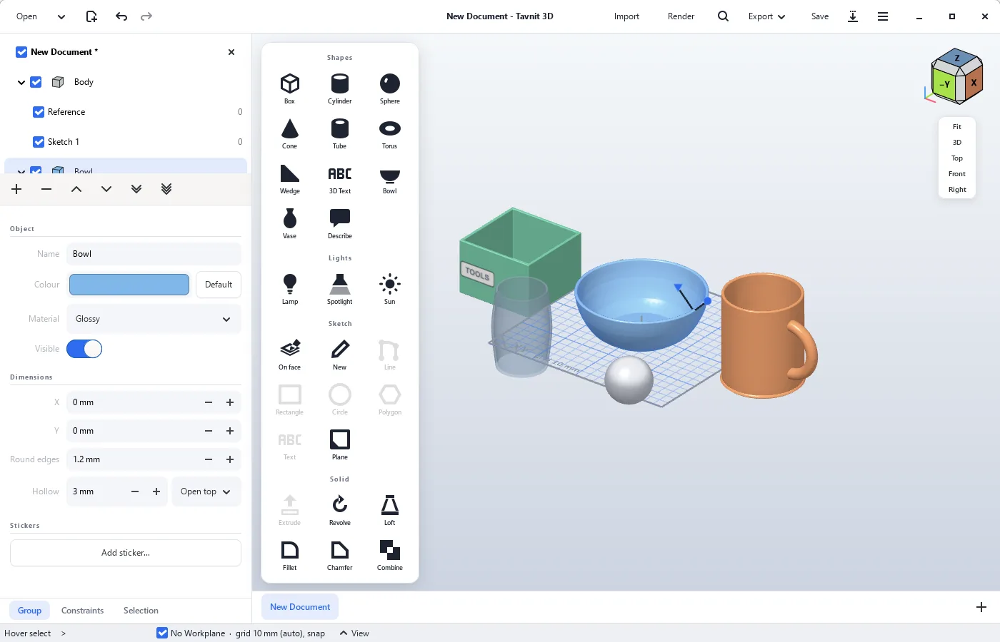

# Tavnit 3D

A friendlier, Tinkercad/Shapr3D-style take on [Dune 3D](https://dune3d.org/)
for Windows: ready-made shapes on a floor grid, click an object to edit its
size, position, colour and material, then export STL for 3D printing or
render a photo-like picture - with the full parametric CAD underneath.

**Download:** <https://star69995.github.io/tavnit3d/en/> (English) or
<https://star69995.github.io/tavnit3d/> (Hebrew). Windows 10/11, 64-bit
installer; the app checks for new versions at start and updates itself in
one click.

## What it adds to Dune 3D

- A "studio" look in light and dark (Preferences > Appearance and theme): a tool palette with categories
  (Shapes, Lights, Sketch, Edit, Look, Import), an object panel of cards with a slider for each size, a
  start screen with big action cards, ready-made shapes, recent files with a picture of each and a note
  about unsaved work, and a Find box in the header
- New window (Ctrl+Shift+N) and Open in a new window (Ctrl+Shift+O): a separate window next to the first
- Ready-made Box, Cylinder, Sphere, Cone, Tube, Torus, Wedge, 3D Text,
  Hexagon, Triangle, Star, Heart, Dome, Screw, Bowl and Vase, placed next to
  each other on a floor grid; a picture as a flat object
- Holes (Tinkercad-style): turn any object into a hole, or add a round one,
  move it into another object and press Cut
- Make objects from a description ("a mug with a handle") with an AI service
  of your choice (Claude, OpenAI, Gemini, OpenRouter, or any OpenAI-compatible
  address, with your own API key) - or with no key at all: copy a ready prompt
  into any chatbot and paste its answer back. They come out as ordinary,
  editable shapes
- Click a solid to select it; an object panel shows its dimensions, X/Y
  position, colour, material (satin/matte/glossy/metal/glass) and visibility;
  handles on the object (squares on its edges for a size, an arrow above it to lift) resize and move it by dragging
- Drag to move (hold Shift to move along one axis only; hints at the bottom say how; the floor is
  a fixed size you can change in View > Grid and floor settings), lift off the floor
  (Z field, or the Lift handle dragged up), duplicate (Ctrl+D), copies in a row, round all edges, hollow
  out (cups, bowls, boxes), join/subtract/intersect
- Automatic backups of unsaved work, offered back after a crash
- Stickers: pictures on an object's surface, also on curved sides; patterns
  (stripes, dots, checker, grid) in a choice of colours that cover the surface
- Lights (lamp, spotlight, sun) that light the 3D view
- Render photo-like pictures with Blender (free, installed separately) in the
  background: size, quality, background, floor shadows
- Import STEP, IGES, glTF/GLB and OBJ with their colours and materials; export
  glTF with colours, materials, stickers, lights and the view (for Blender,
  PowerPoint, the web) besides STL and STEP
- Find (Ctrl+K): search for any command and see where it is in the window
- Sketch on a face, push/pull extrude with a typed distance (negative cuts)
- Snap to a grid with a selectable size, studio lighting, one-click STL/STEP
  export
- Windows installer (per user, no admin rights) and in-app updates from this
  repo's GitHub releases

The app's own UI is in English; the website is in English and Hebrew.

## Where the code comes from

Tavnit 3D is a fork of **[Dune 3D](https://github.com/dune3d/dune3d)** by
Lukas K. and contributors, and is licensed, like Dune 3D, under the
[GNU GPL v3](LICENSE). Dune 3D in turn builds on
[Open CASCADE](https://dev.opencascade.org/) (geometry kernel),
[SolveSpace](https://solvespace.com/)'s constraint solver and GTK 4. All
credit for the CAD core goes to them. This is not an official Dune 3D
release - please report problems with Tavnit 3D
[here](https://github.com/Star69995/tavnit3d/issues), not upstream.
Generally useful fixes are offered back to Dune 3D as pull requests.

**Written mostly by Claude.** Most of the code that Tavnit 3D adds on top of
Dune 3D was written by Claude, an AI model by Anthropic (via Claude Code),
with Star deciding what to build, testing it in real use and choosing what
goes in. Commits are marked with a `Co-Authored-By: Claude` line, and the full
history is public in this repository.

## Building (Windows)

Needs MSYS2 (UCRT64) with the packages from `.github/workflows/win32.yml`.
`tools\build.cmd` builds, `tools\build.cmd test` also runs the tests,
`tools\build.cmd dist installer` makes the portable folder and the setup.exe.
Releases are published with `tools/release.sh` - see `CLAUDE.md` for details.

Branches: `studio` is Tavnit 3D (default), `main` mirrors upstream Dune 3D.

---

*Below is the original Dune 3D README.*

# Dune 3D

Dune 3D is a parametric 3D CAD application that supports STEP import/export, fillets and chamfers.

## Motivation

So why another open-source 3D CAD application when FreeCAD and Solvespace exist?
My primary use case for 3D CAD is designing 3D-printed enclosures for my electronics projects. I often found myself procrastinating designing the enclosure and attributed that to my dissatisfaction with the available open source 3D CAD applications.

While FreeCAD technically does everything I need, the way it's implemented isn't quite to my liking. My biggest pain points with it are the modal sketcher that only works in 2D, no constraints in 3D for extrusions and the perils of referencing things in the design.

Solvespace on the other hand gets the workflow part right, but falls short by not importing STEP and the geometry kernel not supporting chamfers and fillets.

Having solved the similar problem for PCB CAD by developing Horizon EDA, I began pondering whether I could pull off the same thing for 3D CAD. After all, what does it take to make a 3D CAD?

 - Geometry kernel to do extrusions, intersections, chamfers, etc.: While it's not a nice library to work with, Open CASCADE is the only viable choice if we want to have STEP import/export and fillets/chamfers. Fortunately, I have some experience with it from dealing with STEP files in Horizon EDA.
 - 3D viewport: Obviously, we need a way to put 3D geometry on screen, zoom/pan and select things. The 3D preview in Horizon EDA already does all of this, so I have a well-understood codebase I can reuse.
 - Constraint solver: Unlike with Horizon EDA where things just stay where you last moved them, in 3D CAD, it's commonplace to specify where things go by means of constraints that need to be solved. Turns out that Solvespace's solver is available as a library[^1], so that part's also covered.
 - Editor infrastructure: Last but not least, we need code that takes care of the tools, undo/redo and all of the other bits and pieces that make up an interactive editor. While there'll be some differences, I felt confident that I could reuse and adapt the interactive manipulator from Horizon EDA.

With all of the building blocks available, I set out to glue them together to form a 3D CAD application. About three months later, it's somewhat presentable.

[^1]: I ended up directly using solvespace's solver instead of the suggested [wrapper code](https://github.com/solvespace/solvespace/blob/master/exposed/DOC.txt) since it didn't expose all of the features I needed.
I also had to patch the solver to make it sufficiently fast for the kinds of equations I was generating by symbolically solving equations where applicable.

## How to build

See the [build instructions](https://docs.dune3d.org/en/latest/build-linux.html).

## How to use

Similar to Horizon EDA, all tools and actions are available from the spacebar menu.

Use the "set workplane" tool to set a group's workplane.

Also check out the [documentation](https://docs.dune3d.org/).

## Where to go with questions

The project's discussion platforms are a [matrix room](https://matrix.to/#/#dune3d:selfnet.de) and [GitHub Discussions](https://github.com/dune3d/dune3d/discussions).

## Anticipated questions

### Where do I find sample files?

See the [samples](https://github.com/dune3d/samples) repository.

### Does it run on Windows?

See the [build instructions](https://docs.dune3d.org/en/latest/build-win32.html) for how to build on Windows.

### Does it run on macOS?

See the [build instructions](https://docs.dune3d.org/en/latest/build-macos.html) for how to build on macOS.

### Why not integrate it into Horizon EDA?

There's no place in Horizon EDA where a 3D CAD would make sense to implement. Also, I wanted to do some things differently and give Gtk 4 a try.

### Why not improve Solvespace or FreeCAD?

Making FreeCAD parametric in 3D or putting Open CASCADE into Solvespace seemed to be too big a change to pull off as an outside contributor to either project. I also really like writing CAD software, so here we are.

